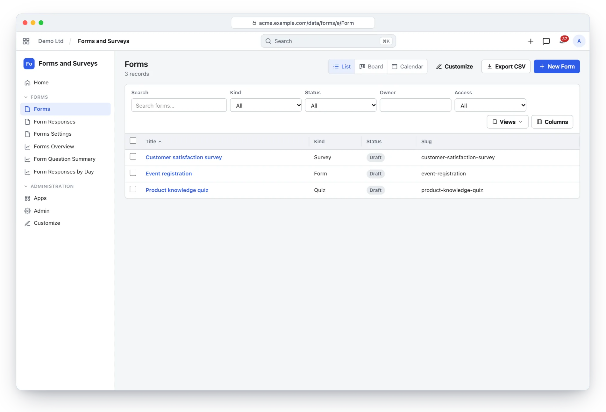
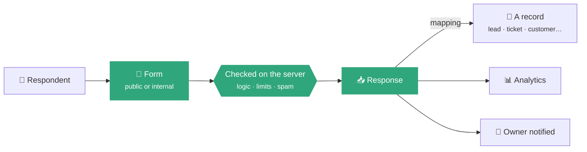
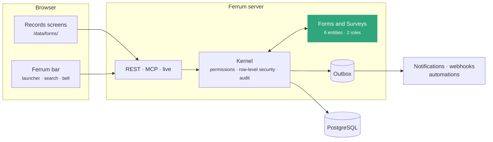
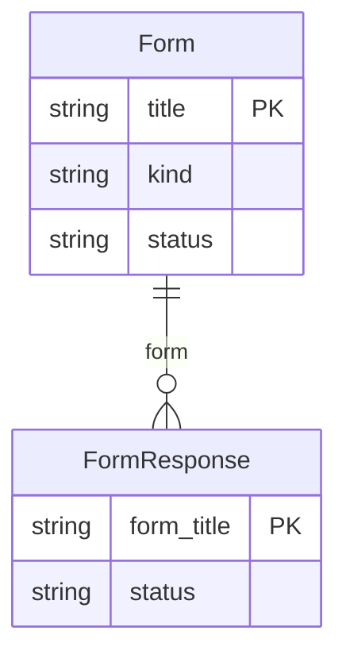

<div align="center">

<picture>
  <source media="(prefers-color-scheme: dark)" srcset="docs/assets/banner-dark.svg">
  
</picture>

[](https://github.com/CBFerrum/ferrum-app-forms/actions/workflows/ci.yml)     

**A native app for [Ferrum](https://github.com/CBFerrum/Ferrum), the open-source, AI-first business platform.**

[Overview](#overview) · [Highlights](#highlights) · [Screenshots](#screenshots) · [How it works](#how-it-works) · [Data model](#data-model) · [Install](#install) · [Develop](#develop) · [Changelog](#changelog)

</div>

---

## Overview

Ferrum Forms is one engine for forms, surveys and quizzes: 21 question types, conditional logic
in CEL, answers checked on the server, public or internal access with limits that hold under
concurrency, an anonymous mode that keeps nothing about the respondent, and a mapping that turns
each response into a record (a lead, a ticket, a customer, any entity).


| At a glance | |
|---|---|
| 📦 Version | `0.1.0` |
| 🧱 Platform | Ferrum `>=0.3, <0.4` |
| 🔗 Requires | nothing else |
| 🖥️ Interface | Ferrum's records screens (`/data/forms/`) |
| 🗃️ Records | 6 entities in 1 package |
| 👥 Roles | 2: Forms Manager, Forms User |
| 📊 Reports | 3 |
| 🧪 Tests | 28 Rust tests |


## Highlights

<table>
<tr>
<td width="50%" valign="top">

### 🧱 21 question types
Text to matrices, ratings, NPS, Likert, ranking and file uploads.

</td>
<td width="50%" valign="top">

### 🔀 Conditional logic
CEL over earlier answers, for questions and whole pages.

</td>
</tr>
<tr>
<td width="50%" valign="top">

### 🛡️ Checked on the server
Every answer validated and normalized; spam traps and idempotent submits.

</td>
<td width="50%" valign="top">

### 🕶️ Anonymous when asked
No email, name, user or IP address kept.

</td>
</tr>
<tr>
<td width="50%" valign="top">

### 🧩 Responses become records
Map answers onto any entity, checked against the live schema.

</td>
<td width="50%" valign="top">

### 📊 Exact analytics
Distributions, NPS, Likert and matrix breakdowns, trends and CSV exports.

</td>
</tr>
</table>

## Screenshots

<picture>
  <source media="(prefers-color-scheme: dark)" srcset="docs/assets/forms-dark.webp">
  
</picture>

<p align="center"><sub>Forms, surveys and quizzes with their status.</sub></p>

> [!TIP]
> The screenshots follow your GitHub theme: switch between light and dark to see both.

## How it works

### A response



### Inside Ferrum



Everything Forms and Surveys adds is ordinary Ferrum metadata and Rust: its records get lists, forms,
search, permissions, an audit trail, exports and the REST and MCP APIs for free, so AI agents work
with them under the same rules as people.

## Data model

The main records and how they connect (6 entities in all; `packages/` has every field).



### Roles

| Role | What it is for | Entities |
|---|---|---|
| **Forms Manager** | Every form and every response, form ownership and the Forms settings. | 3 |
| **Forms User** | Builds forms, surveys and quizzes and works the responses of the forms they own (created, or named as owner). | 2 |

<details>
<summary><b>Reports (3)</b></summary>

- Forms Overview
- Form Question Summary
- Form Response Trend

</details>

## Install

Workspace administrators install it from **Apps** (`/store/`) in Ferrum; it ships in the
official Ferrum server image. Self-hosters building their own image enable the
`forms` feature of the server. Everything it adds is also available to AI agents over
Ferrum's MCP server, within each person's permissions.

## Develop

Clone it next to the platform:

```text
work/
├── ferrum/            https://github.com/CBFerrum/Ferrum
└── ferrum-app-forms/
```

Point the platform dependencies at your checkout (this file is git-ignored):

```toml
# .cargo/config.toml
[patch."https://github.com/CBFerrum/Ferrum"]
ferrum-calc = { path = "../ferrum/crates/calc" }
ferrum-domain = { path = "../ferrum/crates/domain" }
ferrum-kernel = { path = "../ferrum/crates/kernel" }
ferrum-meta = { path = "../ferrum/crates/meta" }
```

The tests need PostgreSQL with an ordinary (non-superuser) role, so row-level security
applies:

```bash
createuser ferrum --pwprompt && createdb -O ferrum ferrum_forms_test
cargo test
```

`FERRUM_FORMS_TEST_DATABASE_URL` overrides the database URL.


### Project layout

```text
app.yaml      the manifest: id, version, requirements, what it adds to Ferrum
packages/     metadata: entities, roles, reports, workflows, print formats
src/          the app's logic in Rust: hooks, actions, endpoints, upkeep jobs
tests/        integration tests against a real PostgreSQL
CHANGELOG.md  what changed in each version
```


It builds on [ferrum-app-comms](https://github.com/CBFerrum/ferrum-app-comms).

## Changelog

| Version | Highlights |
|---|---|
| **0.1.0** | First release: one engine for forms, surveys and quizzes. Forms hold 21 question types with lengths, bounds, linear-time patterns, defaults and … |

Every version is in [CHANGELOG.md](CHANGELOG.md).

## License

[AGPL-3.0-only](LICENSE), like the platform. Part of [Ferrum](https://github.com/CBFerrum/Ferrum) ·
[Report an issue](https://github.com/CBFerrum/ferrum-app-forms/issues)
