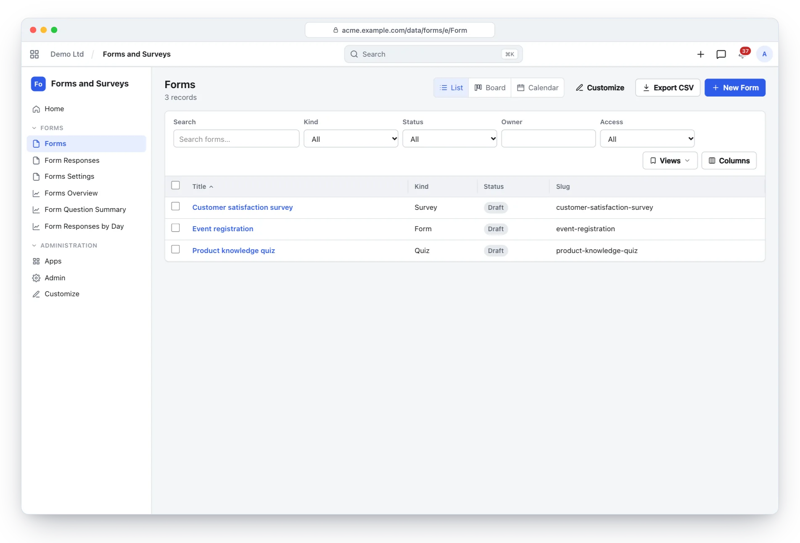
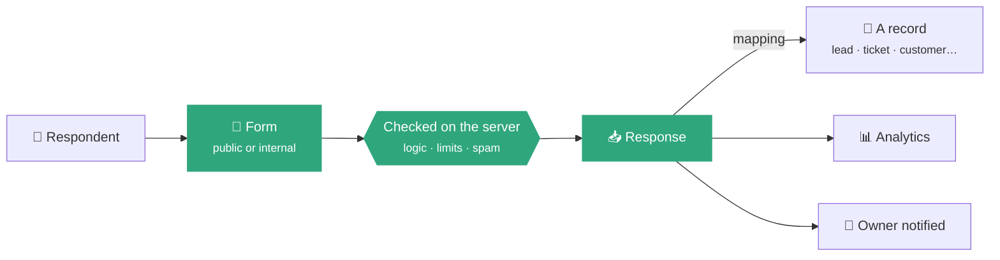
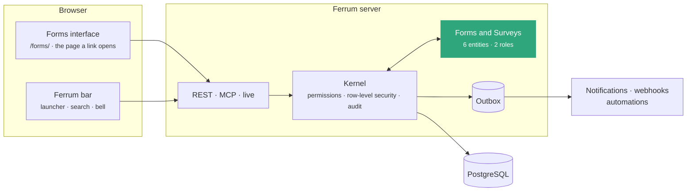
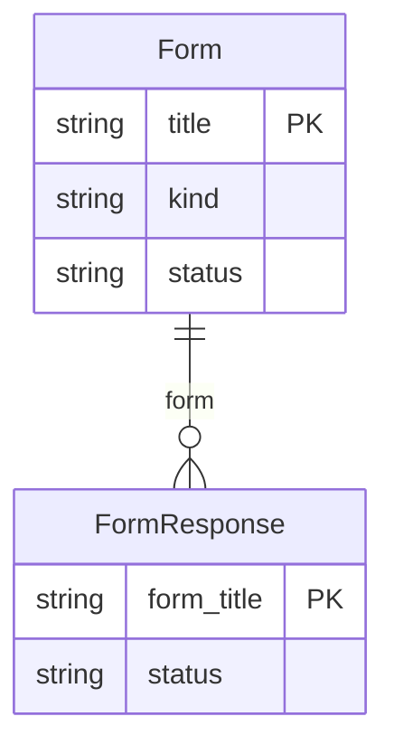

<div align="center">

<picture>
  <source media="(prefers-color-scheme: dark)" srcset="docs/assets/banner-dark.svg">
  
</picture>

[](https://github.com/CBFerrum/ferrum-app-forms/actions/workflows/ci.yml)      

**A native app for [Ferrum](https://github.com/CBFerrum/Ferrum), the open-source, AI-first business platform.**

[Overview](#overview) · [Highlights](#highlights) · [Screenshots](#screenshots) · [How it works](#how-it-works) · [Data model](#data-model) · [Install](#install) · [Develop](#develop) · [Changelog](#changelog)

</div>

---

## Overview

Ferrum Forms is one engine for forms, surveys and quizzes: 21 question types, conditional logic
in CEL, answers checked on the server, public or internal access with limits that hold under
concurrency, an anonymous mode that keeps nothing about the respondent, and a mapping that turns
each response into a record (a lead, a ticket, a customer, any entity). A form's link opens a
page anyone can fill in on a phone or a computer, page by page or one question at a time;
people who build forms get a builder with a live preview, and the results with a chart for each
question.


| At a glance | |
|---|---|
| 📦 Version | `0.2.0` |
| 🧱 Platform | Ferrum `>=0.3, <0.4` |
| 🔗 Requires | nothing else |
| 🖥️ Interface | its own, at `/forms/`, and the page a form's link opens |
| 🗃️ Records | 6 entities in 1 package |
| 👥 Roles | 2: Forms Manager, Forms User |
| 📊 Reports | 3 |
| 🧪 Tests | 30 Rust tests, 8 interface test files |


## Highlights

<table>
<tr>
<td width="50%" valign="top">

### 🧱 21 question types
Text to matrices, ratings, NPS, Likert, ranking and file uploads.

</td>
<td width="50%" valign="top">

### 🔀 Conditional logic
CEL over earlier answers, for questions and whole pages.

</td>
</tr>
<tr>
<td width="50%" valign="top">

### 🛡️ Checked on the server
Every answer validated and normalized; spam traps and idempotent submits.

</td>
<td width="50%" valign="top">

### 🕶️ Anonymous when asked
No email, name, user or IP address kept.

</td>
</tr>
<tr>
<td width="50%" valign="top">

### 🧩 Responses become records
Map answers onto any entity, checked against the live schema.

</td>
<td width="50%" valign="top">

### 📊 Exact analytics
Distributions, NPS, Likert and matrix breakdowns, trends and CSV exports.

</td>
</tr>
</table>

## Screenshots

<picture>
  <source media="(prefers-color-scheme: dark)" srcset="docs/assets/forms-dark.webp">
  
</picture>

<p align="center"><sub>Forms, surveys and quizzes with their status.</sub></p>

> [!TIP]
> The screenshots follow your GitHub theme: switch between light and dark to see both.

## How it works

### A response



### Inside Ferrum



Everything Forms and Surveys adds is ordinary Ferrum metadata and Rust: its records get lists, forms,
search, permissions, an audit trail, exports and the REST and MCP APIs for free, so AI agents work
with them under the same rules as people.

## Data model

The main records and how they connect (6 entities in all; `packages/` has every field).



### Roles

| Role | What it is for | Entities |
|---|---|---|
| **Forms Manager** | Every form and every response, form ownership and the Forms settings. | 3 |
| **Forms User** | Builds forms, surveys and quizzes and works the responses of the forms they own (created, or named as owner). | 2 |

<details>
<summary><b>Reports (3)</b></summary>

- Forms Overview
- Form Question Summary
- Form Response Trend

</details>

## Install

Workspace administrators install it from **Apps** (`/store/`) in Ferrum; it ships in the
official Ferrum server image. Self-hosters building their own image enable the
`forms` feature of the server. Everything it adds is also available to AI agents over
Ferrum's MCP server, within each person's permissions.

## Develop

Clone it next to the platform:

```text
work/
├── ferrum/            https://github.com/CBFerrum/Ferrum
└── ferrum-app-forms/
```

Point the platform dependencies at your checkout (this file is git-ignored):

```toml
# .cargo/config.toml
[patch."https://github.com/CBFerrum/Ferrum"]
ferrum-apps = { path = "../ferrum/crates/apps" }
ferrum-calc = { path = "../ferrum/crates/calc" }
ferrum-domain = { path = "../ferrum/crates/domain" }
ferrum-kernel = { path = "../ferrum/crates/kernel" }
ferrum-meta = { path = "../ferrum/crates/meta" }
```

The tests need PostgreSQL with an ordinary (non-superuser) role, so row-level security
applies:

```bash
createuser ferrum --pwprompt && createdb -O ferrum ferrum_forms_test
cargo test
```

`FERRUM_FORMS_TEST_DATABASE_URL` overrides the database URL.


Its tests also build on [ferrum-app-comms](https://github.com/CBFerrum/ferrum-app-comms) and [ferrum-app-erp](https://github.com/CBFerrum/ferrum-app-erp), which Cargo takes from GitHub.
To work on them alongside this app, clone them into the same folder and add to the same file:

```toml
[patch."https://github.com/CBFerrum/ferrum-app-comms"]
ferrum-app-comms = { path = "../ferrum-app-comms" }
[patch."https://github.com/CBFerrum/ferrum-app-erp"]
ferrum-app-erp = { path = "../ferrum-app-erp" }
```


The interface lives in `ui/` and builds with Ferrum-Frontend's packages (cloned into `ferrum/web`):

```bash
cd ui
npm run build      # ui/dist, checked against the size budget
npm test
```

The page a respondent opens is `/forms/f/{workspace}/{form}` (`shell.public` in `app.yaml`); the
rest of the interface sits behind sign-in. With a development server started with
`FERRUM_DEV_UI=1`, `ferrum-app dev --ui` serves the pages from Vite behind the real bar and
session, with hot reload.


### Project layout

```text
app.yaml      the manifest: id, version, requirements, what it adds to Ferrum
packages/     metadata: entities, roles, reports, workflows, print formats
src/          the app's logic in Rust: hooks, actions, endpoints, upkeep jobs
ui/           its own interface (React + Vite), built into ui/dist
tests/        integration tests against a real PostgreSQL
CHANGELOG.md  what changed in each version
```

## Changelog

| Version | Highlights |
|---|---|
| **0.2.15** | Its names in Arabic and Hindi; the last English sentences translated. |
| **0.2.14** | Sentences built in code are words too, in Arabic and Hindi. |
| **0.2.13** | The assistant knows its records. |
| **0.2.12** | Rebuilt with Ferrum-Frontend 5b22e7b: its own words in Arabic and Hindi. |
| **0.2.11** | Rebuilt with Ferrum-Frontend 6537d65: once-shown answers kept; English isolated right to left; its own words translatable by a workspace. |
| **0.2.10** | Rebuilt with Ferrum-Frontend d5d98f2: a workspace's own interface words; pictures in attachment fields; a duplicate value said so; its own screens mirror right to left. |
| **0.2.9** | Rebuilt with Ferrum-Frontend 63280d3: right to left, pages mirror; the records pages' words in Arabic and Hindi. |
| **0.2.8** | Rebuilt with Ferrum-Frontend a64416a: a box whose default is 1 shows ticked. |
| **0.2.7** | Rebuilt with Ferrum-Frontend 922fcfb: action dialogs say every refusal and ask once. |
| **0.2.6** | Rebuilt with Ferrum-Frontend a76295e: times on a person's own clock when they chose one. |
| **0.2.5** | Times on the workspace's clock; rebuilt with Ferrum-Frontend 24c3951. |
| **0.2.4** | Rebuilt with Ferrum-Frontend bb60115: empty numbers read as the server reads them; settings open as their record. |
| **0.2.3** | Rebuilt with Ferrum-Frontend 00dea07: a workflow state's kept fields are read-only, its needed ones required. |
| **0.2.2** | Rebuilt with Ferrum-Frontend daeadda: actions say what they did. |
| **0.2.1** | Rebuilt with Ferrum-Frontend 80ff179: labels name their fields, and linked titles show their titles. |
| **0.2.0** | The page a form's link opens, a form builder with a live preview, settings in one place, and results with a chart for each question. |
| **0.1.0** | First release: one engine for forms, surveys and quizzes. Forms hold 21 question types with lengths, bounds, linear-time patterns, defaults and … |

Every version is in [CHANGELOG.md](CHANGELOG.md).

## License

[AGPL-3.0-only](LICENSE), like the platform. Part of [Ferrum](https://github.com/CBFerrum/Ferrum) ·
[Report an issue](https://github.com/CBFerrum/ferrum-app-forms/issues)
